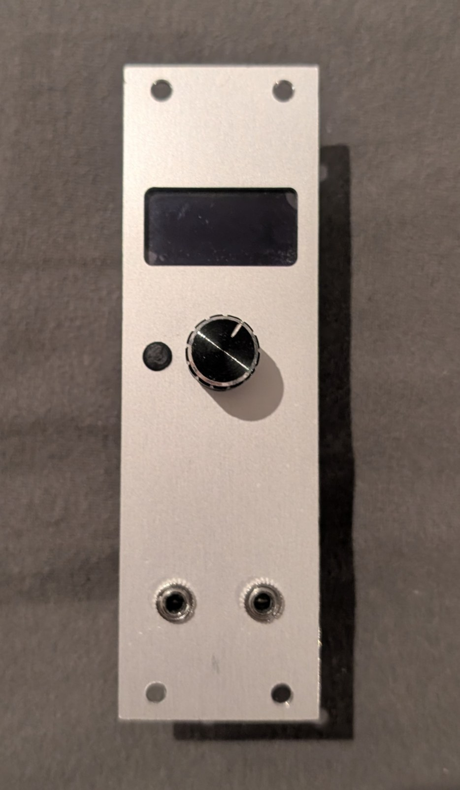

# Eurorack Oscilloscope



A compact, multi-function signal analyser for Eurorack modular synthesisers. Built around an RP2040 microcontroller, it samples two CV/audio inputs simultaneously via DMA-driven ADC and displays the result on a 128×64 OLED. Six apps are accessible from a navigation menu: oscilloscope, FFT spectrum analyser, Lissajous display, chromatic tuner, voltmeter, and PSU monitor.

---

## Features

- **Dual-channel simultaneous sampling** — RP2040 ADC in round-robin DMA mode captures both inputs at sample rates from ~1 Hz up to 200 kHz per channel
- **Six display apps** — each app configures its own optimal sample rate on entry
- **Rotary encoder navigation** — single encoder with push-button + back button controls all menus and in-app settings
- **128×64 SH1106G OLED** — SPI-connected monochrome display
- **Per-rack PSU monitoring** — voltage and current on ±12 V and +5 V rails via INA226 sensors and ADS1115 ADC

---

## Apps

### Oscilloscope
Triggered waveform display with adjustable time base and amplitude scaling.

- **Channels:** CH1, CH2, or CH1+CH2 overlay
- **Time base:** 1 s, 500 ms, 250 ms, 100 ms, 50 ms, 25 ms, 10 ms, 5 ms
- **Amplitude:** ±10 V, ±5 V, ±2 V, ±1 V, ±0.5 V, ±0.2 V, ±0.1 V
- **Trigger:** Rising zero-crossing on the active channel (25 % headroom buffer, 20 mV hysteresis)
- **Readout:** Vpp displayed per trace; dual-channel mode shows both

### FFT Spectrum Analyser
Real-time frequency spectrum using a 2048-point FFT with Hann windowing.

- **Sample rate:** 32768 Hz (~16 fps)
- **Frequency range:** selectable upper limit — 1 kHz, 2 kHz, 4 kHz, 8 kHz, 16 kHz
- **Channel select:** toggle between CH1 and CH2 with encoder press
- **Max range select:** hold encoder press to switch to frequency-range editing mode
- **Readout:** Detected fundamental frequency (Hz) via Harmonic Product Spectrum

### Lissajous Display
XY plot of CH1 (horizontal) vs CH2 (vertical) over the full sample buffer.

- **Time base:** same options as the oscilloscope (controls how much signal history is captured per frame)
- **Amplitude:** same ±V options as the oscilloscope (scales both axes equally)
- **UI overlay:** parameter labels are visible for 2 seconds after any encoder interaction, then the full screen is given to the plot

### Chromatic Tuner
Pitch detection with note name, octave, and cent deviation display.

- **Sample rate:** 4096 Hz
- **Detection:** Harmonic Product Spectrum on a 2048-point FFT
- **Smoothing:** 8-sample moving average on the detected pitch
- **Display:** note name + octave (e.g. `A4`), frequency in Hz, cent deviation bar with a triangle cursor (±50 ¢ range)
- **Channel:** CH1

### Voltmeter
DC voltage, RMS, min and max for both channels simultaneously.

- **Update rate:** ~30 Hz (61440 Hz sample rate / 2048 samples)
- **Display:** large DC readout for CH1 and CH2, with min/max lines below each

### PSU Monitor
Power-supply rail monitoring for two separate PSU buses (A and B).

- **Rails:** +5 V, +12 V, −12 V
- **Modes:** Voltage view and Current view (toggle with encoder)
- **Hardware:** INA226 current-sense ICs (I²C) + ADS1115 ADC for voltage measurement

---

## Hardware

### Components

| Part | Description |
|---|---|
| RP2040 (e.g. Raspberry Pi Pico) | Main microcontroller |
| SH1106G 128×64 OLED | SPI display |
| Rotary encoder with push-button | Navigation |
| Momentary push-button | Back / cancel |
| INA226 × 6 | Current sensing on PSU rails |
| ADS1115 | Voltage measurement on PSU rails |
| Resistor divider network | Scales ±12 V Eurorack signals to RP2040 ADC range |
| Eurorack 3U panel | Front plate (drawings and STL in `Hardware/1.0/`) |

### Signal Input

The two CV/audio inputs are connected to RP2040 GPIO28 (ADC2) and GPIO29 (ADC3).  
A resistor voltage-divider network attenuates and level-shifts the ±12 V Eurorack signal range into the 0–3.3 V ADC input range.

**Calibration constants (baked into firmware — do not change without re-calibrating):**
- `ADC_INPUT_OFFSET_VOLTS = 1.4942857` — mid-rail offset after divider
- `ADC_INPUT_DIVIDER_GAIN = 0.1291666` — divider attenuation factor

### Pin Assignment

| Signal | GPIO |
|---|---|
| Encoder A | GPIO12 |
| Encoder B | GPIO13 |
| Encoder button | GPIO11 |
| Back button | GPIO15 |
| OLED MOSI | GPIO3 |
| OLED CLK | GPIO5 |
| OLED DC | GPIO7 |
| OLED CS | GPIO14 |
| OLED RESET | GPIO8 |
| I²C SDA | GPIO0 |
| I²C SCL | GPIO1 |
| CV Input CH1 | GPIO28 (ADC2) |
| CV Input CH2 | GPIO29 (ADC3) |

### PCB & Front Panel

KiCad board files, 3D STEP exports, and a front panel STL are located in `Hardware/1.0/`.

---

## Software Setup

### 1. Install the RP2040 board package in Arduino IDE

1. Open **Arduino IDE** (2.x recommended).
2. Go to **File → Preferences**.
3. In the *Additional boards manager URLs* field, add:
   ```
   https://github.com/earlephilhower/arduino-pico/releases/download/global/package_rp2040_index.json
   ```
4. Click **OK**, then open **Tools → Board → Boards Manager**.
5. Search for **"Raspberry Pi Pico/RP2040"** (by Earle F. Philhower, III) and click **Install**.
6. After installation, select **Tools → Board → Raspberry Pi RP2040 Boards → Raspberry Pi Pico** (or your specific board variant).

### 2. Install required libraries

Install all of the following via **Tools → Manage Libraries** (or the Library Manager in Arduino IDE 2):

| Library | Author | Purpose |
|---|---|---|
| **Adafruit GFX Library** | Adafruit | Graphics primitives |
| **Adafruit SH110X** | Adafruit | SH1106G OLED driver |
| **Adafruit BusIO** | Adafruit | I²C/SPI abstraction (dependency) |
| **Adafruit ADS1X15** | Adafruit | ADS1115 ADC for PSU voltages |
| **INA226_WE** | Wolfgang Ewald | INA226 current sensing |
| **PicoEncoder** | (search "PicoEncoder") | Interrupt-driven rotary encoder |

The CMSIS-DSP library used for FFT (`arm_math.h`) is bundled with the Earle Philhower RP2040 board package and requires no separate installation.

### 3. Build and flash

1. Clone or download this repository.
2. Open `EurorackScope/EurorackScope.ino` in Arduino IDE.
3. Select the correct board and port under **Tools**.
4. Hold the **BOOTSEL** button on the Pico while connecting USB to enter bootloader mode, then click **Upload**.

---

## Repository Structure

```
EurorackScope/          Arduino sketch and all source files
  EurorackScope.ino     Entry point (setup / loop)
  DSP.cpp / .h          ADC + DMA engine, dual-channel sample acquisition
  DSPChannel.cpp / .h   Per-channel FFT, Hann window, HPS, voltmeter stats
  ScopeApp.cpp / .h     Oscilloscope app
  FFTApp.cpp / .h       FFT spectrum analyser app
  LissajousApp.cpp / .h Lissajous XY display app
  TunerApp.cpp / .h     Chromatic tuner app
  VoltmeterApp.cpp / .h Dual voltmeter app
  PSUApp.cpp / .h       PSU monitor app
  PSU.cpp / .h          INA226 + ADS1115 PSU sensing driver
  UI.cpp / .h           App switcher, menu renderer, encoder handling
  Buttons.cpp / .h      Debounced push-button driver
  App.h                 Base class for all apps (onEnter / onExit / draw)
  Menu.h                Menu data structures and mode constants
  UIContext.h           Context struct passed to every app on each frame
  pinout.h              All GPIO pin definitions
Hardware/
  1.0/
    Board1/             Main PCB (KiCad, STEP, gerbers)
    Board2/             Front panel PCB or daughter board
```
